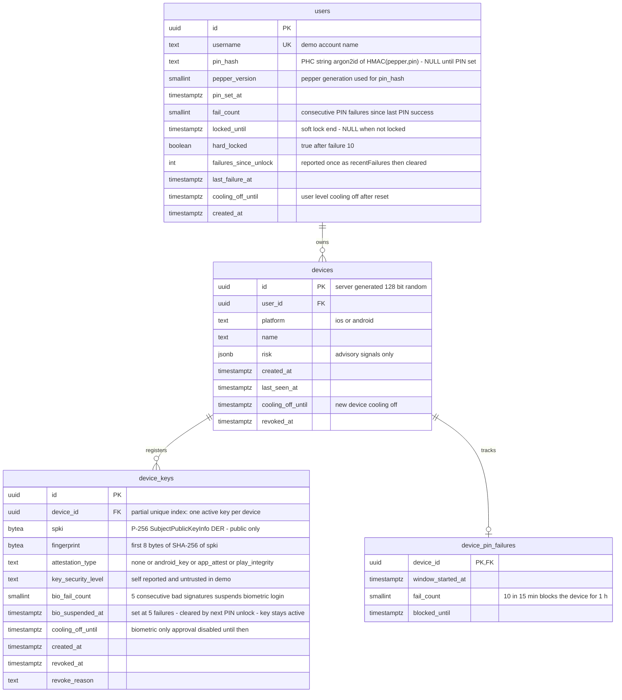

# ERD 01: Identity and devices

[ERD index](./README.md) (constraints, notes and SEC mapping live there)

Who the user is, which devices they registered, PIN lockout state and the hardware-backed biometric key per device.

