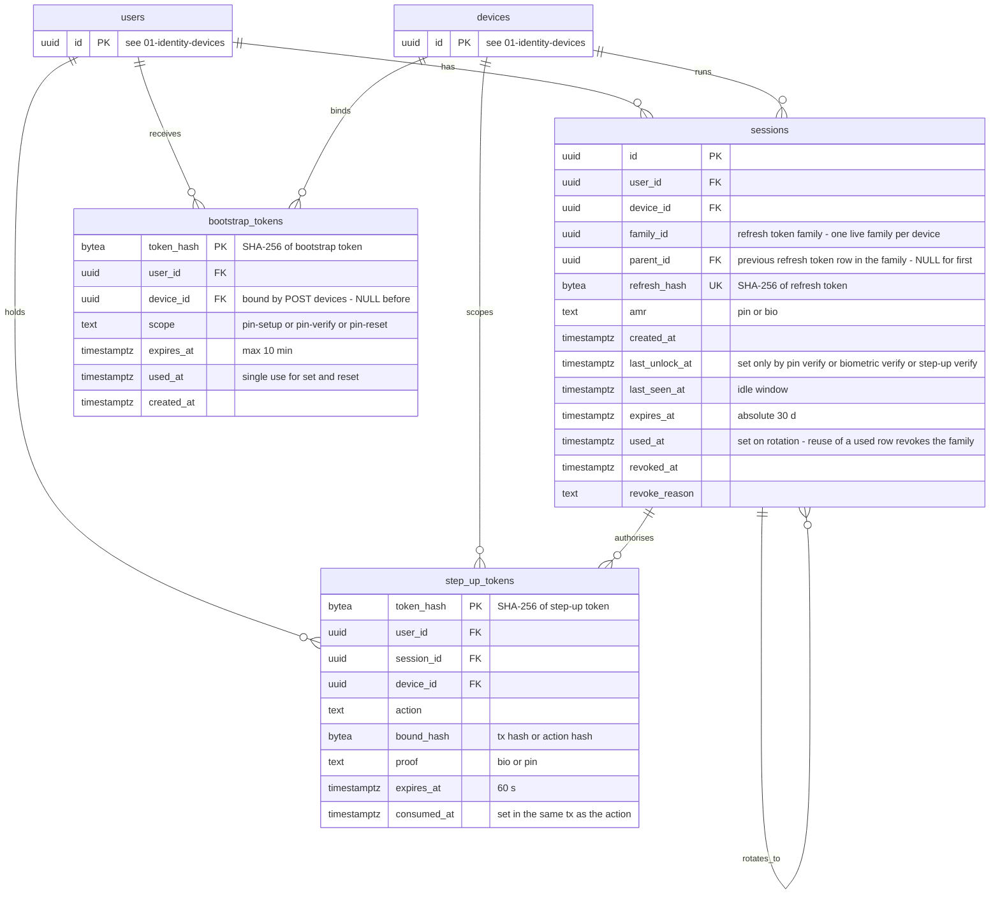

# ERD 02: Sessions and tokens

[ERD index](./README.md) (constraints, notes and SEC mapping live there)

Refresh-token families (rotation and reuse detection), single-use bootstrap tokens for PIN setup/verify/reset, and short-lived step-up tokens.

Tables from other diagrams are shown with their key only: `users` ([01-identity-devices](./01-identity-devices.md)), `devices` ([01-identity-devices](./01-identity-devices.md)).

