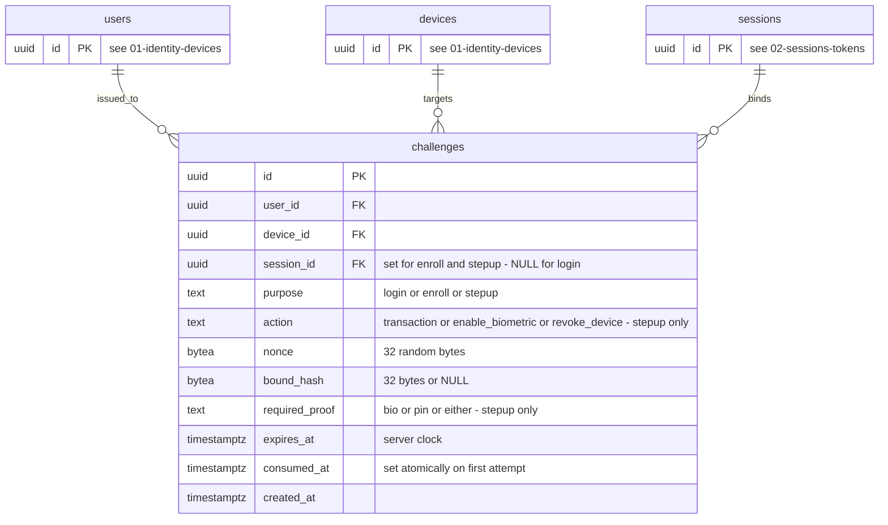

# ERD 03: Challenges

[ERD index](./README.md) (constraints, notes and SEC mapping live there)

Server nonces signed by the device key for biometric login, biometric enrollment and step-up.

Tables from other diagrams are shown with their key only: `users` ([01-identity-devices](./01-identity-devices.md)), `devices` ([01-identity-devices](./01-identity-devices.md)), `sessions` ([02-sessions-tokens](./02-sessions-tokens.md)).

