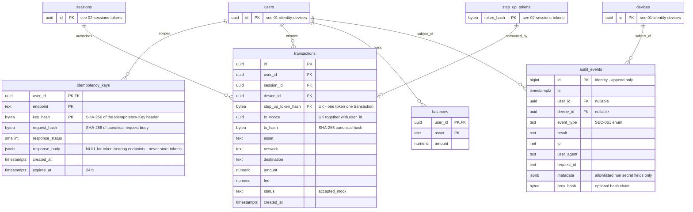

# ERD 04: Transactions, idempotency and audit

[ERD index](./README.md) (constraints, notes and SEC mapping live there)

Mock send transactions and balances, idempotency records and the append-only audit log.

Tables from other diagrams are shown with their key only: `users` ([01-identity-devices](./01-identity-devices.md)), `devices` ([01-identity-devices](./01-identity-devices.md)), `sessions` ([02-sessions-tokens](./02-sessions-tokens.md)), `step_up_tokens` ([02-sessions-tokens](./02-sessions-tokens.md)).

