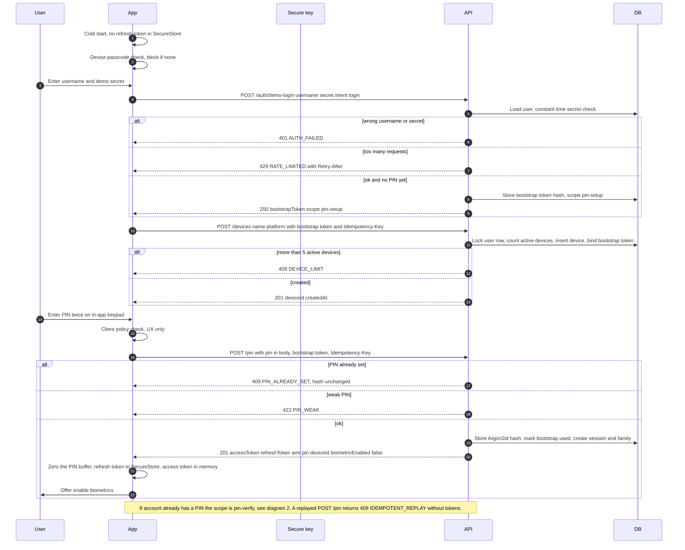

# 1. First launch, demo-login, device registration, PIN setup

[Index](./README.md) · [2. PIN unlock with soft lock and hard lock](./02-pin-unlock-lockout.md) →

SEC: 001, 002, 004, 015, 016, 034, 048, 052, 053, 060.
