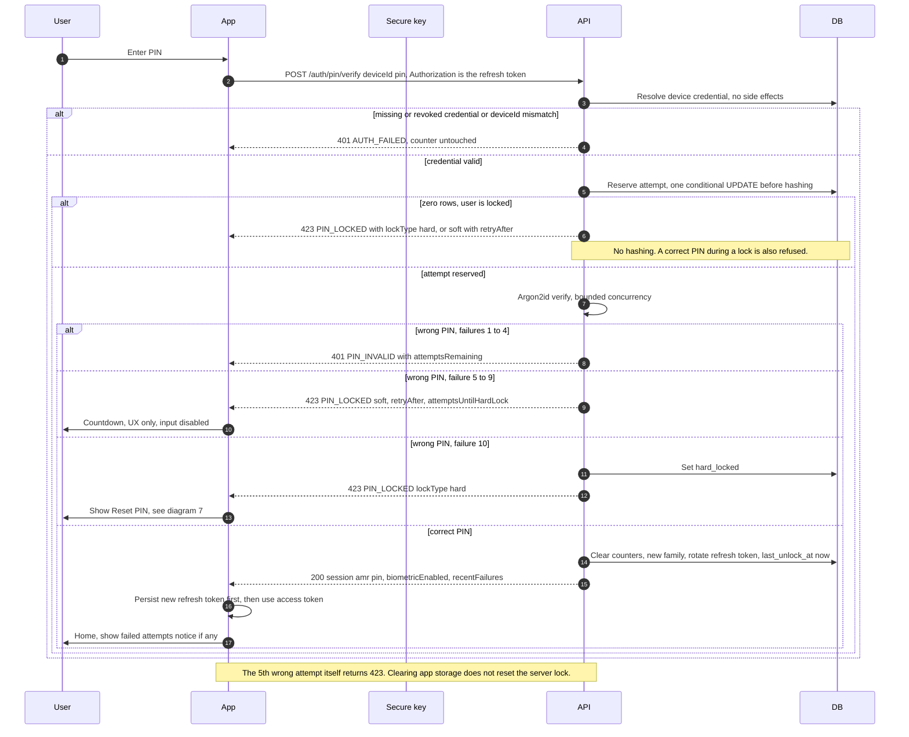

# 2. PIN unlock with soft lock and hard lock

← [1. First launch, demo-login, device registration, PIN setup](./01-first-launch-pin-setup.md) · [Index](./README.md) · [3. Enable biometrics (two-step enroll with fresh PIN and proof of possession)](./03-enable-biometrics.md) →

SEC: 005, 005b, 008, 009, 010, 011, 012, 013, 014, 037.
