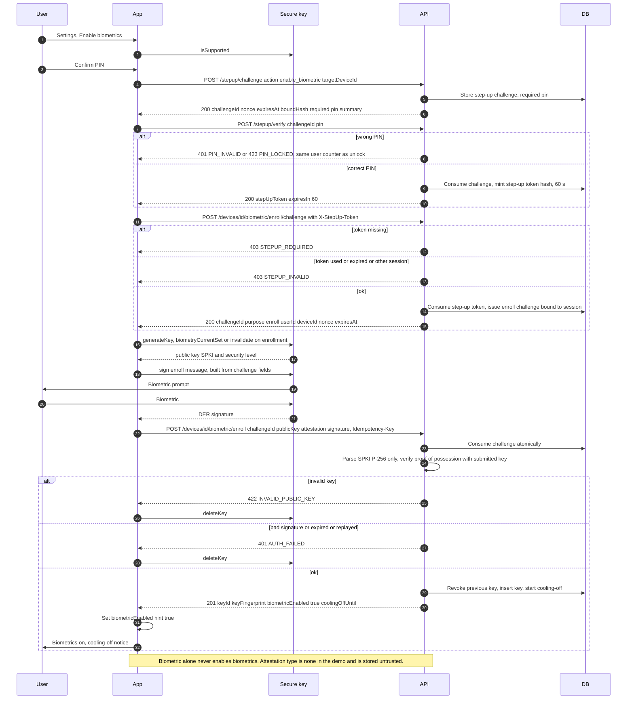

# 3. Enable biometrics (two-step enroll with fresh PIN and proof of possession)

← [2. PIN unlock with soft lock and hard lock](./02-pin-unlock-lockout.md) · [Index](./README.md) · [4. Biometric unlock with PIN fallback](./04-biometric-unlock.md) →

SEC: 017, 018, 020, 021, 022, 026, 027, 038, 042, 047, 054.
