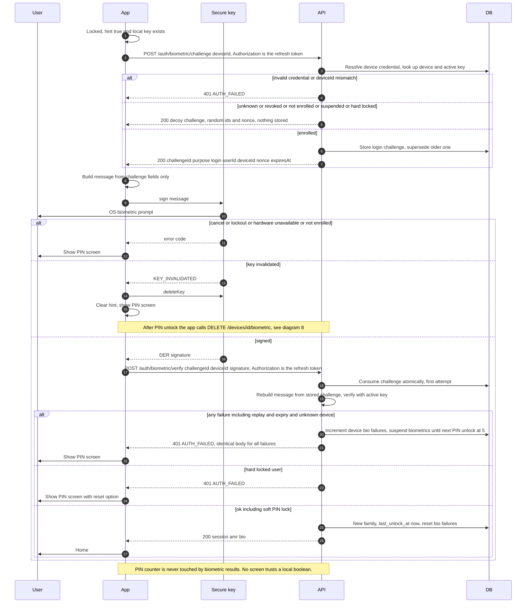

# 4. Biometric unlock with PIN fallback

← [3. Enable biometrics (two-step enroll with fresh PIN and proof of possession)](./03-enable-biometrics.md) · [Index](./README.md) · [5. Refresh with rotation and reuse detection](./05-refresh-rotation.md) →

SEC: 019, 023, 025, 026, 027, 028, 029, 030, 037, 054.
