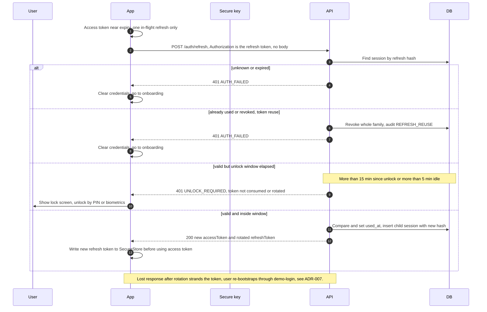

# 5. Refresh with rotation and reuse detection

← [4. Biometric unlock with PIN fallback](./04-biometric-unlock.md) · [Index](./README.md) · [6. Step-up send transaction (biometric under BIO_ONLY_MAX, PIN above, server recomputed hash)](./06-step-up-transaction.md) →

SEC: 014, 031, 032, 033, 034, 035, 036, 037.
