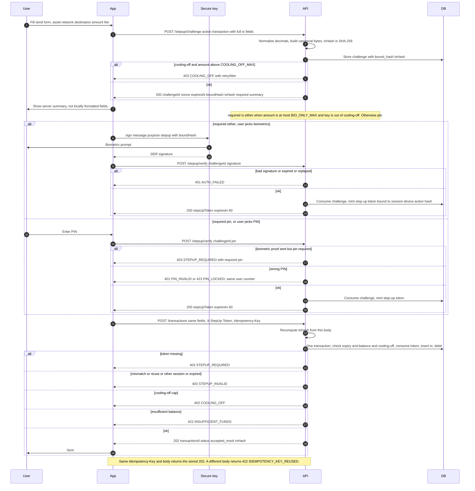

# 6. Step-up send transaction (biometric under BIO_ONLY_MAX, PIN above, server recomputed hash)

← [5. Refresh with rotation and reuse detection](./05-refresh-rotation.md) · [Index](./README.md) · [7. Change PIN, PIN reset and hard-lock recovery with cooling-off](./07-change-reset-recover-pin.md) →

SEC: 026, 027, 038, 039, 040, 041, 042, 043, 044, 047, 060.
