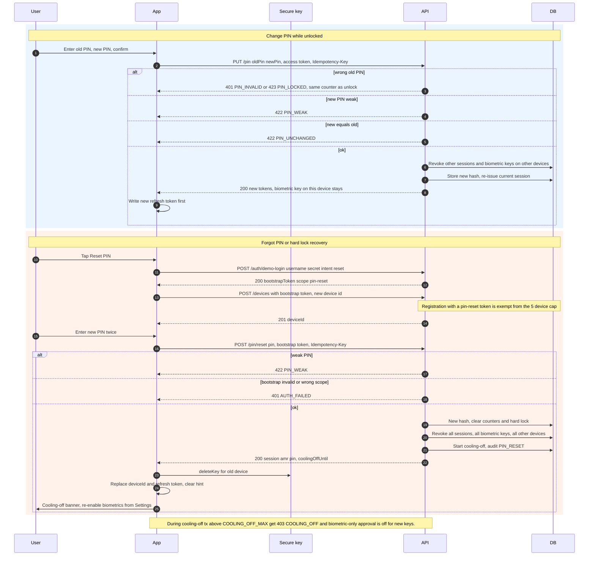

# 7. Change PIN, PIN reset and hard-lock recovery with cooling-off

← [6. Step-up send transaction (biometric under BIO_ONLY_MAX, PIN above, server recomputed hash)](./06-step-up-transaction.md) · [Index](./README.md) · [8. Disable biometrics and revoke device](./08-disable-biometrics-revoke-device.md) →

SEC: 001, 011, 016, 024, 036, 045, 046, 047, 048.
