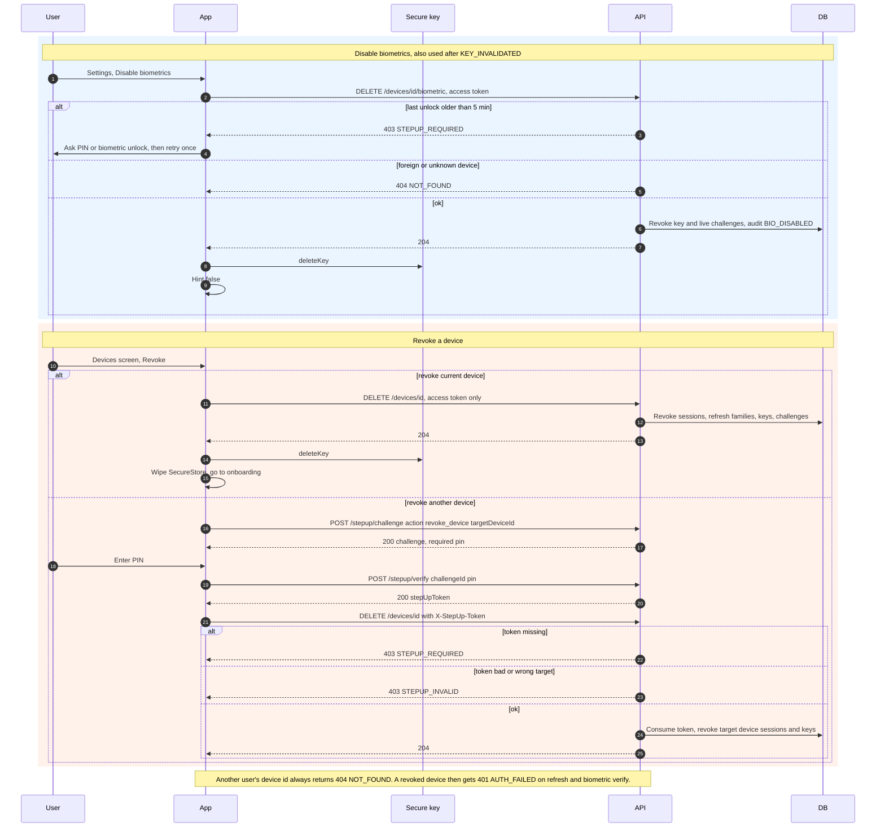

# 8. Disable biometrics and revoke device

← [7. Change PIN, PIN reset and hard-lock recovery with cooling-off](./07-change-reset-recover-pin.md) · [Index](./README.md) · [9. App launch decision and auto-lock](./09-app-launch-auto-lock.md) →

SEC: 023, 024, 036, 038, 048, 049.
