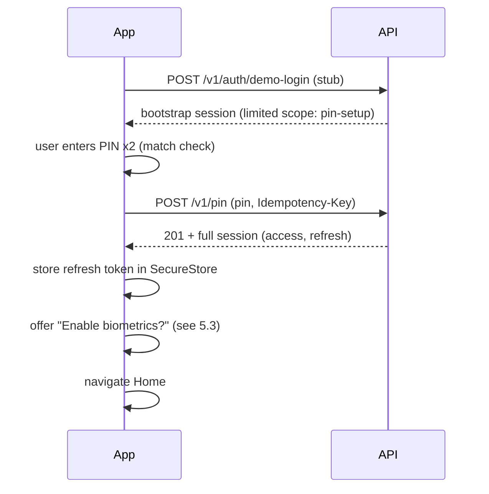
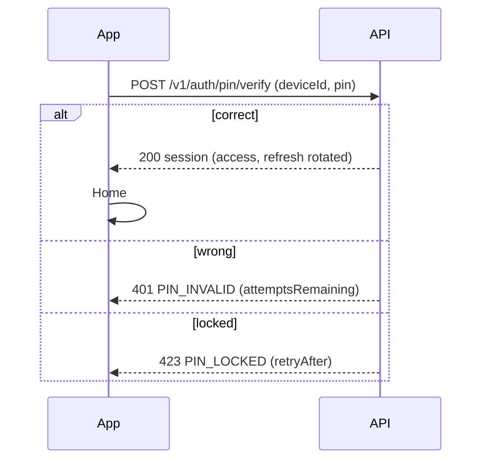
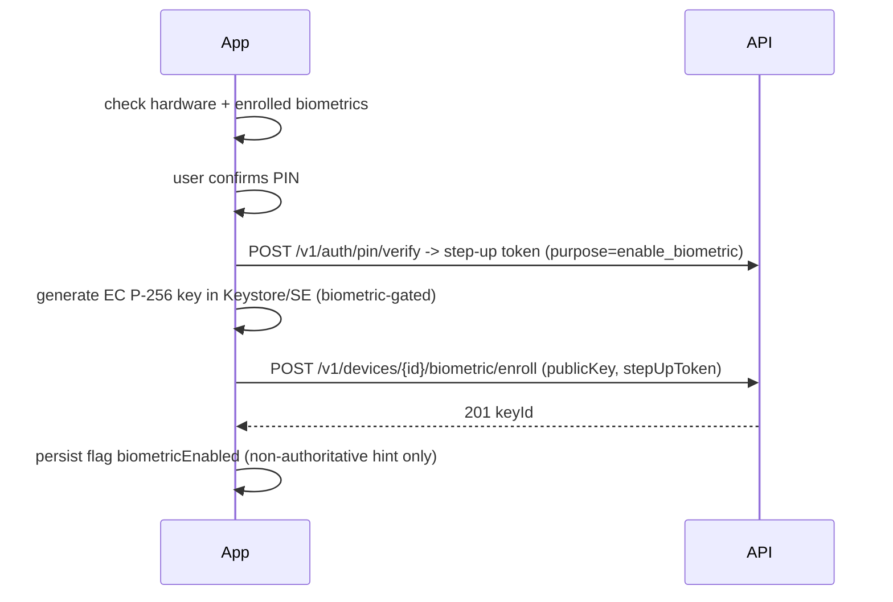
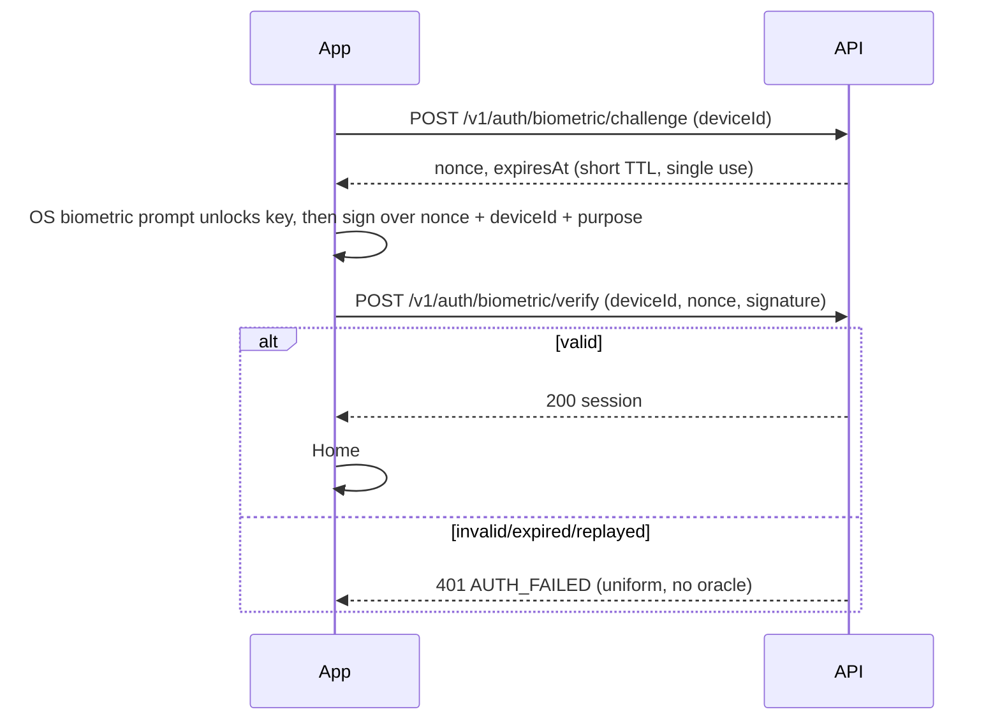
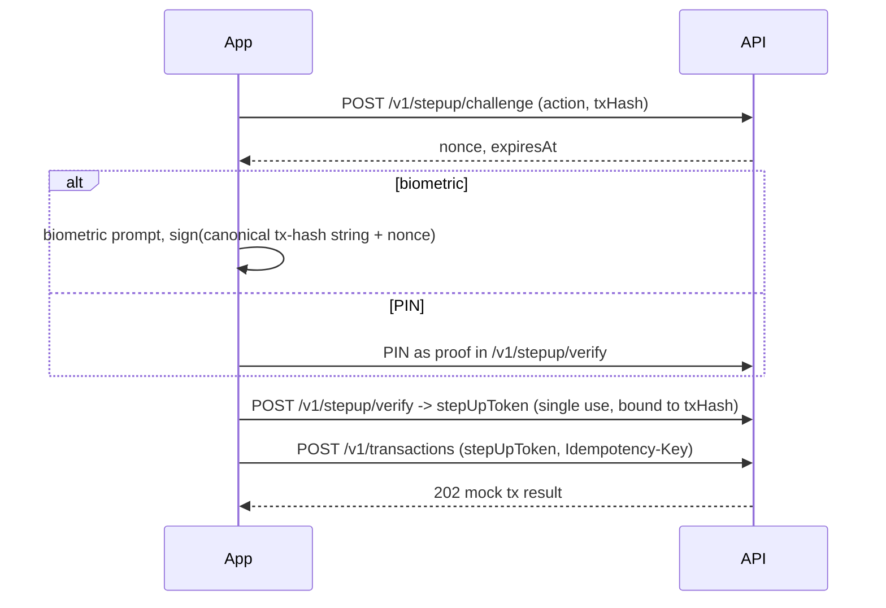

# Draft: Biometric + PIN login (slug: biometric-pin-login)

Status: Phase 1 draft, pending security-specialist input. Greenfield repo, no existing code.

## 1. Goal
App unlock gate for a demo crypto app. If biometrics are not enabled, the user unlocks with a PIN. If enabled, the user unlocks with biometrics (PIN as fallback). Success leads to the Home Dashboard (mock balances).

## 2. User stories
- U1: As a new user, I set a 6-digit PIN on first launch so the app is protected.
- U2: As a user, I unlock with my PIN.
- U3: As a user, I enable biometrics in Settings (after PIN confirmation) so I can unlock faster.
- U4: As a user with biometrics enabled, I am prompted for biometrics at launch; on failure/cancel I can use PIN.
- U5: As a user, I can disable biometrics, change my PIN, or revoke a device.
- U6: As a user, I am locked out temporarily after repeated wrong PINs.
- U7: As a user, I can do a (demo) send transaction that requires step-up re-authentication.

## 3. Scope / non-goals
In scope: PIN setup/verify/change/reset, biometric enrol/unlock bound to a hardware-backed device key, lockout, session issuance, step-up for sensitive actions, device list/revoke, demo dashboard with mock balances (static data served by backend or client constants; no real funds, no chain access).
Out of scope: real wallets/keys/transactions, KYC, account registration/primary credential login (assume a demo account + initial session via a stub `demo login`), push notifications, web client, multi-account, server-side account recovery beyond PIN reset via re-login, jailbreak/root attestation (question Q12).

## 4. Principles
- Biometrics never produce a bare boolean. Success = hardware-backed private key (Keystore/Secure Enclave, `biometryCurrentSet`/auth-required) signs a server nonce; server verifies against the registered public key.
- PIN is verified server-side (not locally comparable), rate-limited per user/device. Client never stores the PIN.
- Never log PINs, tokens, keys, signatures.

## 5. Flows

### 5.1 First launch / PIN setup

### 5.2 PIN unlock (biometrics off)

### 5.3 Enable biometrics

Server is authoritative for "biometric enabled" per device.

### 5.4 Biometric unlock

### 5.5 Fallback biometric -> PIN
User cancels, OS biometric lockout, key invalidated (biometric set changed), or server rejects -> show PIN screen. If key invalidated: client calls `DELETE /v1/devices/{id}/biometric` after PIN verify, and shows "Biometrics disabled, re-enable in Settings".

### 5.6 Lockout
Server-side counter per user (and per device): N consecutive wrong PINs -> temporary lock with escalating backoff; after M total -> hard lock requiring re-login (demo-login + PIN reset). Biometric unlock is blocked while the account is hard locked; whether it is blocked during a soft PIN lock is Q5. Client displays countdown from `retryAfter`, does not enforce lock itself.

### 5.7 Step-up for transaction (demo send)

### 5.8 Change / reset PIN; disable biometrics; revoke device
- Change PIN: old PIN + new PIN -> `PUT /v1/pin`; revokes other sessions (Q9); biometric stays enabled.
- Reset PIN (forgot): requires re-authentication via demo-login (stands in for password+OTP); disables biometrics on all devices (Q9).
- Disable biometrics: `DELETE /v1/devices/{id}/biometric` (needs session; PIN step-up per Q8); client deletes key.
- Revoke device: `DELETE /v1/devices/{id}` (step-up); server revokes its sessions, refresh tokens, public keys.

### 5.9 App launch / lock logic
Launch -> if no refresh token/PIN not set: 5.1. Else local `biometricEnabled` hint true -> 5.4 else 5.2. Auto-lock after background timeout T (Q10); returns to unlock screen. Home dashboard `GET /v1/dashboard` (mock balances) requires valid access token.

## 6. Candidate endpoints (all `/v1`)
| Method | Path | Purpose |
|---|---|---|
| POST | /auth/demo-login | Stub primary login, returns limited bootstrap session |
| POST | /devices | Register device (deviceId, platform, name) |
| GET | /devices | List own devices |
| DELETE | /devices/{id} | Revoke device |
| POST | /pin | Set initial PIN |
| PUT | /pin | Change PIN |
| POST | /auth/pin/verify | PIN unlock -> session |
| POST | /devices/{id}/biometric/enroll | Register public key |
| DELETE | /devices/{id}/biometric | Disable biometrics |
| POST | /auth/biometric/challenge | Issue nonce |
| POST | /auth/biometric/verify | Verify signature -> session |
| POST | /auth/refresh | Rotate refresh token |
| POST | /auth/logout | End session |
| POST | /stepup/challenge, /stepup/verify | Step-up for sensitive action |
| POST | /transactions | Demo send, requires stepUpToken |
| GET | /dashboard | Mock balances/portfolio |

## 7. Data model sketch
- User(id, pin_hash [argon2id, per-user salt, server pepper], pin_set_at, failed_attempts, locked_until, hard_locked)
- Device(id, user_id, platform, name, created_at, last_seen_at, revoked_at)
- DeviceKey(id, device_id, public_key [SPKI DER, P-256], created_at, revoked_at)  -- one active biometric key per device
- Challenge(id, device_id, nonce [32B random], purpose, bound_hash?, expires_at, consumed_at)
- Session(id, user_id, device_id, refresh_token_hash, family_id, expires_at, revoked_at)
- StepUpToken(id, session_id, purpose, bound_hash, expires_at, consumed_at)
- AuditEvent(id, user_id, device_id, type, at, ip) -- no secrets
- Mock data: Wallet/Balance static fixtures (BTC, ETH, USDC) per user.

## 8. Questions for security-specialist
1. PIN format and policy: length (6 digits?), blocklist (1234, repeated, sequences), and is server-side Argon2id with pepper acceptable given a 10^6 keyspace? Should PIN be transmitted raw over TLS, or use an extra layer (e.g. OPAQUE/PAKE, or device-key-signed request)? Is a hardware key signature binding the PIN request to the device required?
2. Lockout policy: exact thresholds, backoff schedule, counting scope (user vs device vs IP), hard-lock criteria, and unlock path.
3. Biometric key spec: algorithm (ES256 P-256), key flags (`biometryCurrentSet` vs `biometryAny`, invalidate on enrollment change), Android StrongBox / Class 3 requirement, iOS Secure Enclave, and whether to require key attestation at enrolment (Android Key Attestation / iOS App Attest).
4. Challenge design: nonce size, TTL, single-use, what is signed (exact message layout, domain separation, device/user/purpose binding), clock handling.
5. Is biometric unlock allowed during a soft PIN lock? Should biometric verify failures also count toward lockout?
6. Token model: access token TTL, refresh rotation with reuse detection, storage on client (SecureStore flags), bearer vs DPoP/device-bound tokens, and whether session assurance level (PIN vs biometric) is included as a claim.
7. Step-up design: which actions require it, TTL, binding to canonical transaction hash, whether biometric alone suffices for transactions or PIN is required above a threshold.
8. Which operations need step-up: enabling/disabling biometrics, changing PIN, revoking devices.
9. Consequences of PIN change/reset: revoke other sessions? disable all biometric keys? How to treat reset when forgotten PIN (re-auth strength required)?
10. Auto-lock timeout and behavior on app backgrounding; screenshot/app-switcher protection; clipboard and keyboard concerns on PIN entry.
11. Rate limiting per endpoint (challenge, verify, refresh, enroll), response headers, and error-response uniformity to avoid enumeration/oracle (e.g. PIN_INVALID vs device unknown).
12. Device integrity: root/jailbreak detection, Play Integrity / App Attest in scope for the demo or explicitly out?
13. Idempotency requirements for state-changing calls and replay windows.
14. Logging/audit: events to record, redaction rules, retention; what must never appear in responses or query strings.
15. Local `biometricEnabled` hint: acceptable to store in plain storage given server is authoritative? Handling of mismatch between local hint and server state.
16. Demo-specific: acceptable simplifications (stub demo-login, in-memory store, mock balances) and which security controls must NOT be relaxed for the demo.
