# ERD: PostgreSQL schema (biometric-pin-login)

Authority for backend migrations (`apps/api/migrations`, task T5 in tasks-backend.md): the migrations MUST match this file; change this file first (via the tech lead), then the migrations. Engine: PostgreSQL 16. Types: `uuid`, `text`, `bytea`, `int`, `smallint`, `bigint`, `boolean`, `timestamptz`, `jsonb`, `numeric(38,18)`.

```mermaid
erDiagram
    users ||--o{ devices : owns
    users ||--o{ sessions : has
    users ||--o{ bootstrap_tokens : receives
    users ||--o{ step_up_tokens : holds
    users ||--o{ challenges : issued_to
    users ||--o{ idempotency_keys : scopes
    users ||--o{ transactions : creates
    users ||--o{ balances : owns
    users ||--o{ audit_events : subject_of
    devices ||--o{ device_keys : registers
    devices ||--o{ sessions : runs
    devices ||--o{ challenges : targets
    devices ||--o| device_pin_failures : tracks
    devices ||--o{ bootstrap_tokens : binds
    devices ||--o{ step_up_tokens : scopes
    devices ||--o{ audit_events : subject_of
    sessions ||--o{ sessions : rotates_to
    sessions ||--o{ step_up_tokens : authorises
    sessions ||--o{ challenges : binds
    sessions ||--o{ transactions : authorises
    step_up_tokens ||--o| transactions : consumed_by

    users {
        uuid id PK
        text username UK "demo account name"
        text pin_hash "PHC string argon2id of HMAC(pepper,pin) - NULL until PIN set"
        smallint pepper_version "pepper generation used for pin_hash"
        timestamptz pin_set_at
        smallint fail_count "consecutive PIN failures since last PIN success"
        timestamptz locked_until "soft lock end - NULL when not locked"
        boolean hard_locked "true after failure 10"
        int failures_since_unlock "reported once as recentFailures then cleared"
        timestamptz last_failure_at
        timestamptz cooling_off_until "user level cooling off after reset"
        timestamptz created_at
    }

    devices {
        uuid id PK "server generated 128 bit random"
        uuid user_id FK
        text platform "ios or android"
        text name
        jsonb risk "advisory signals only"
        timestamptz created_at
        timestamptz last_seen_at
        timestamptz cooling_off_until "new device cooling off"
        timestamptz revoked_at
    }

    device_pin_failures {
        uuid device_id PK, FK
        timestamptz window_started_at
        smallint fail_count "10 in 15 min blocks the device for 1 h"
        timestamptz blocked_until
    }

    device_keys {
        uuid id PK
        uuid device_id FK "partial unique index: one active key per device"
        bytea spki "P-256 SubjectPublicKeyInfo DER - public only"
        bytea fingerprint "first 8 bytes of SHA-256 of spki"
        text attestation_type "none or android_key or app_attest or play_integrity"
        text key_security_level "self reported and untrusted in demo"
        smallint bio_fail_count "5 consecutive bad signatures revokes the key"
        timestamptz cooling_off_until "biometric only approval disabled until then"
        timestamptz created_at
        timestamptz revoked_at
        text revoke_reason
    }

    challenges {
        uuid id PK
        uuid user_id FK
        uuid device_id FK
        uuid session_id FK "set for enroll and stepup - NULL for login"
        text purpose "login or enroll or stepup"
        text action "transaction or enable_biometric or revoke_device - stepup only"
        bytea nonce "32 random bytes"
        bytea bound_hash "32 bytes or NULL"
        text required_proof "bio or pin or either - stepup only"
        timestamptz expires_at "server clock"
        timestamptz consumed_at "set atomically on first attempt"
        timestamptz created_at
    }

    sessions {
        uuid id PK
        uuid user_id FK
        uuid device_id FK
        uuid family_id "refresh token family - one live family per device"
        uuid parent_id FK "previous refresh token row in the family - NULL for first"
        bytea refresh_hash UK "SHA-256 of refresh token"
        text amr "pin or bio"
        timestamptz created_at
        timestamptz last_unlock_at "set only by pin verify or biometric verify or step-up verify"
        timestamptz last_seen_at "idle window"
        timestamptz expires_at "absolute 30 d"
        timestamptz used_at "set on rotation - reuse of a used row revokes the family"
        timestamptz revoked_at
        text revoke_reason
    }

    bootstrap_tokens {
        bytea token_hash PK "SHA-256 of bootstrap token"
        uuid user_id FK
        uuid device_id FK "bound by POST devices - NULL before"
        text scope "pin-setup or pin-verify or pin-reset"
        timestamptz expires_at "max 10 min"
        timestamptz used_at "single use for set and reset"
        timestamptz created_at
    }

    step_up_tokens {
        bytea token_hash PK "SHA-256 of step-up token"
        uuid user_id FK
        uuid session_id FK
        uuid device_id FK
        text action
        bytea bound_hash "tx hash or action hash"
        text proof "bio or pin"
        timestamptz expires_at "60 s"
        timestamptz consumed_at "set in the same tx as the action"
    }

    idempotency_keys {
        uuid user_id PK, FK
        text endpoint PK
        bytea key_hash PK "SHA-256 of the Idempotency-Key header"
        bytea request_hash "SHA-256 of canonical request body"
        smallint response_status
        jsonb response_body "NULL for token bearing endpoints - never store tokens"
        timestamptz created_at
        timestamptz expires_at "24 h"
    }

    audit_events {
        bigint id PK "identity - append only"
        timestamptz ts
        uuid user_id FK "nullable"
        uuid device_id FK "nullable"
        text event_type "SEC-061 enum"
        text result
        inet ip
        text user_agent
        text request_id
        jsonb metadata "allowlisted non secret fields only"
        bytea prev_hash "optional hash chain"
    }

    transactions {
        uuid id PK
        uuid user_id FK
        uuid session_id FK
        uuid device_id FK
        bytea step_up_token_hash FK "UK - one token one transaction"
        uuid tx_nonce "UK together with user_id"
        bytea tx_hash "SHA-256 canonical hash"
        text asset
        text network
        text destination
        numeric amount
        numeric fee
        text status "accepted_mock"
        timestamptz created_at
    }

    balances {
        uuid user_id PK, FK
        text asset PK
        numeric amount
    }
```

Postgres partial and composite unique constraints that Mermaid cannot show:
- `device_keys (device_id) WHERE revoked_at IS NULL` unique (one active key per device).
- `challenges (device_id, purpose) WHERE consumed_at IS NULL` unique (one live challenge per device and purpose; for stepup also scope by session_id).
- `sessions (device_id) WHERE revoked_at IS NULL AND used_at IS NULL` is NOT unique (a family has one live row at a time but old rows stay); the invariant "one live family per device" is enforced in code in the unlock transaction (revoke previous family then insert).
- `transactions (user_id, tx_nonce)` unique; `transactions (step_up_token_hash)` unique.
- `devices` count of active rows per user is limited to 5 in the registration transaction (`SELECT ... FOR UPDATE` on the user row).
- `audit_events`: API role has INSERT only (no UPDATE or DELETE).

## Notes

Sensitive columns (only hashes or public material are ever stored):
- `users.pin_hash`: Argon2id PHC string over `HMAC-SHA256(pepper, pin)`; includes salt and params. The raw PIN and the pepper are never stored. The pepper lives in env or a secret store (SEC-004).
- `sessions.refresh_hash`, `bootstrap_tokens.token_hash`, `step_up_tokens.token_hash`: SHA-256 of 256-bit random tokens; the tokens themselves are never stored. Access tokens are not stored (JWT, checked against `sessions.revoked_at`).
- `device_keys.spki`: public key only; the private key never leaves the device hardware. `fingerprint` is the only form that may appear in audit or logs.
- `challenges.nonce`: random, single use, purge after 24 h; never logged. No signatures are stored anywhere.
- `idempotency_keys.key_hash`/`request_hash`: hashes only; `response_body` is NULL for endpoints that return tokens.
- `audit_events.metadata`: allowlisted keys only; never PIN, tokens, nonces, signatures, public key bytes or hashes.

Table to SEC mapping:

| Table | Supports |
|---|---|
| users (incl. lockout state: fail_count, locked_until, hard_locked, failures_since_unlock) | SEC-001, 003, 004, 005, 008, 009, 010, 011, 012, 015, 042, 045, 046, 047, 066 |
| devices | SEC-024, 047, 048, 049, 056, 064 |
| device_pin_failures | SEC-009, 057 |
| device_keys | SEC-017, 018, 020, 021, 022, 023, 024, 030, 041, 047 |
| challenges | SEC-020, 025, 026, 027, 028, 029, 043, 066 |
| sessions (refresh families) | SEC-014, 031, 032, 033, 035, 036, 037, 066 |
| bootstrap_tokens | SEC-014, 015, 016, 046 |
| step_up_tokens | SEC-020, 038, 039, 040, 041, 042, 043 |
| idempotency_keys | SEC-060, 044 |
| audit_events | SEC-012, 030, 032, 061, 062, 064 |
| transactions, balances | SEC-039, 040, 044, 047 |
| (not in DB) rate-limit buckets | SEC-005b, 057 (in-memory by design, see decisions.md D-12) |
