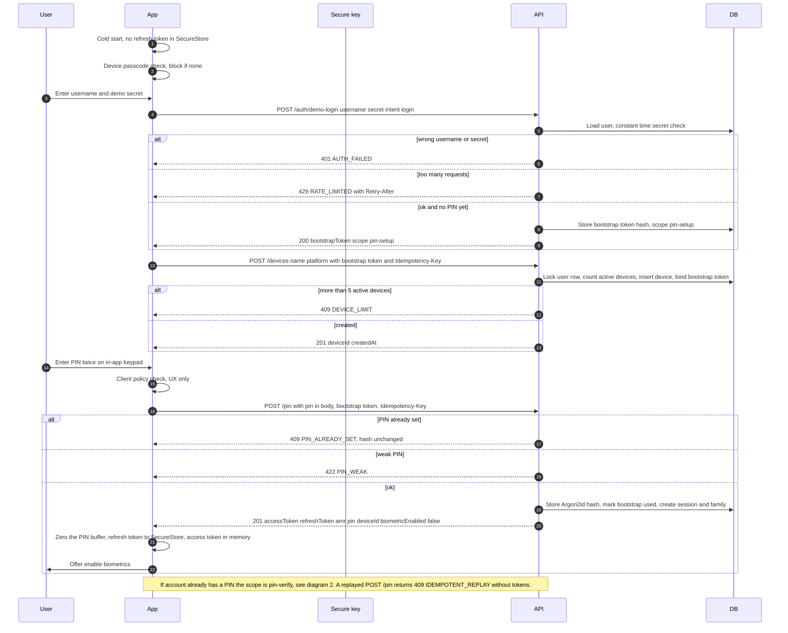
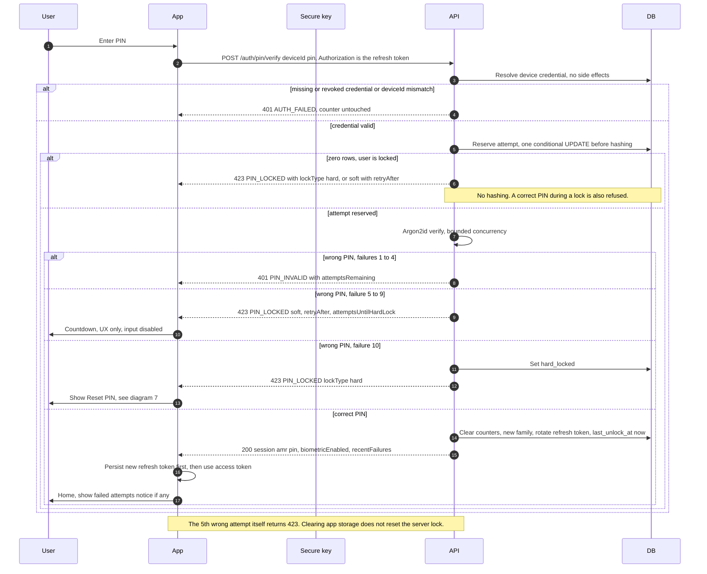
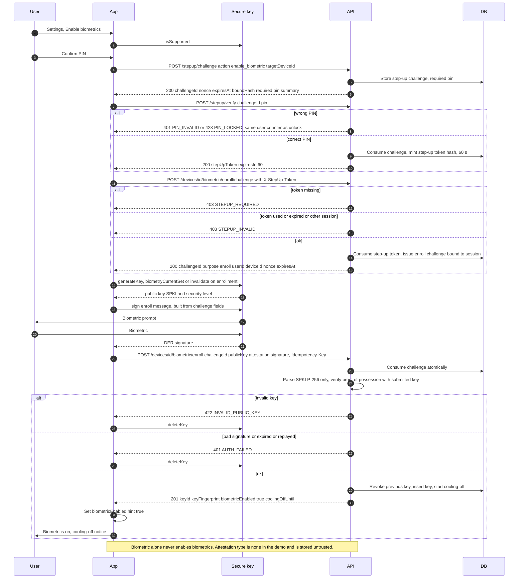
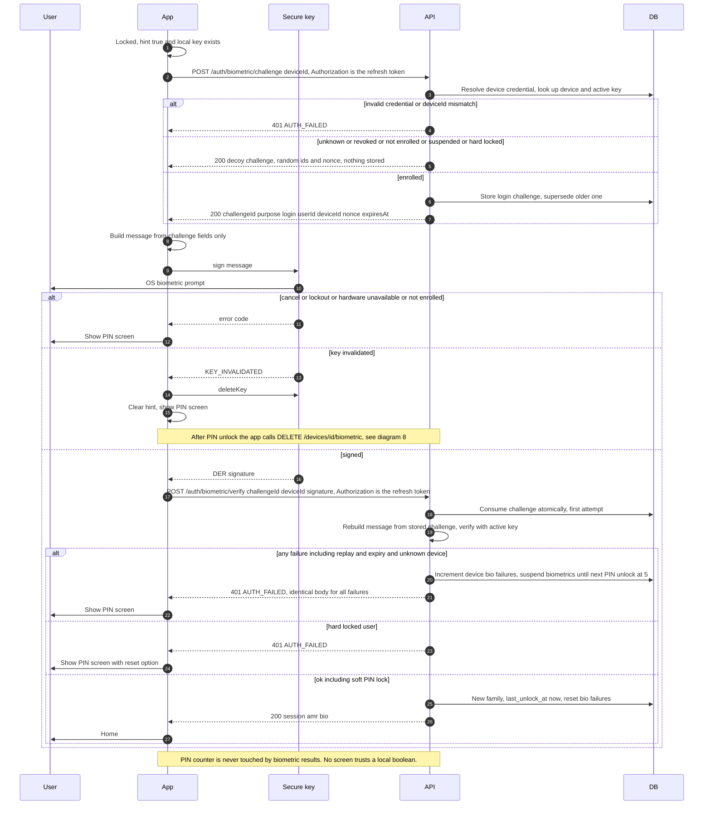
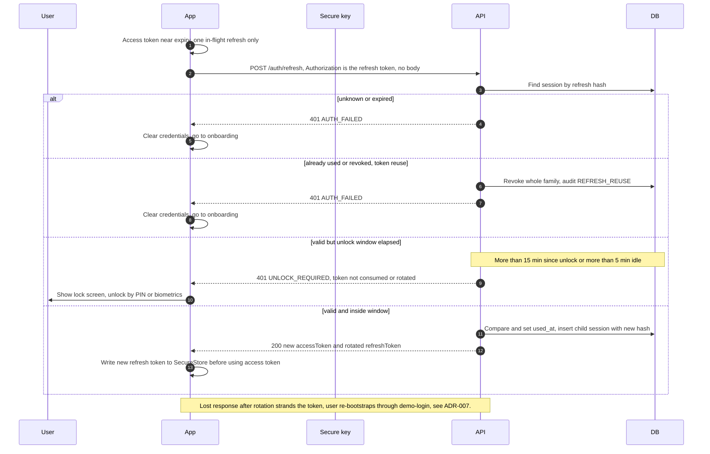
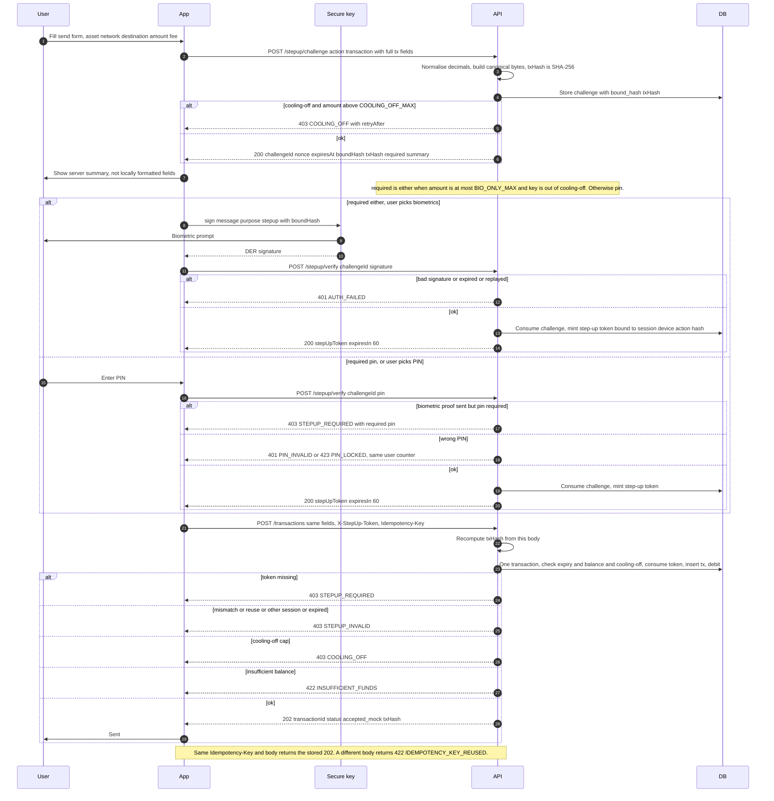
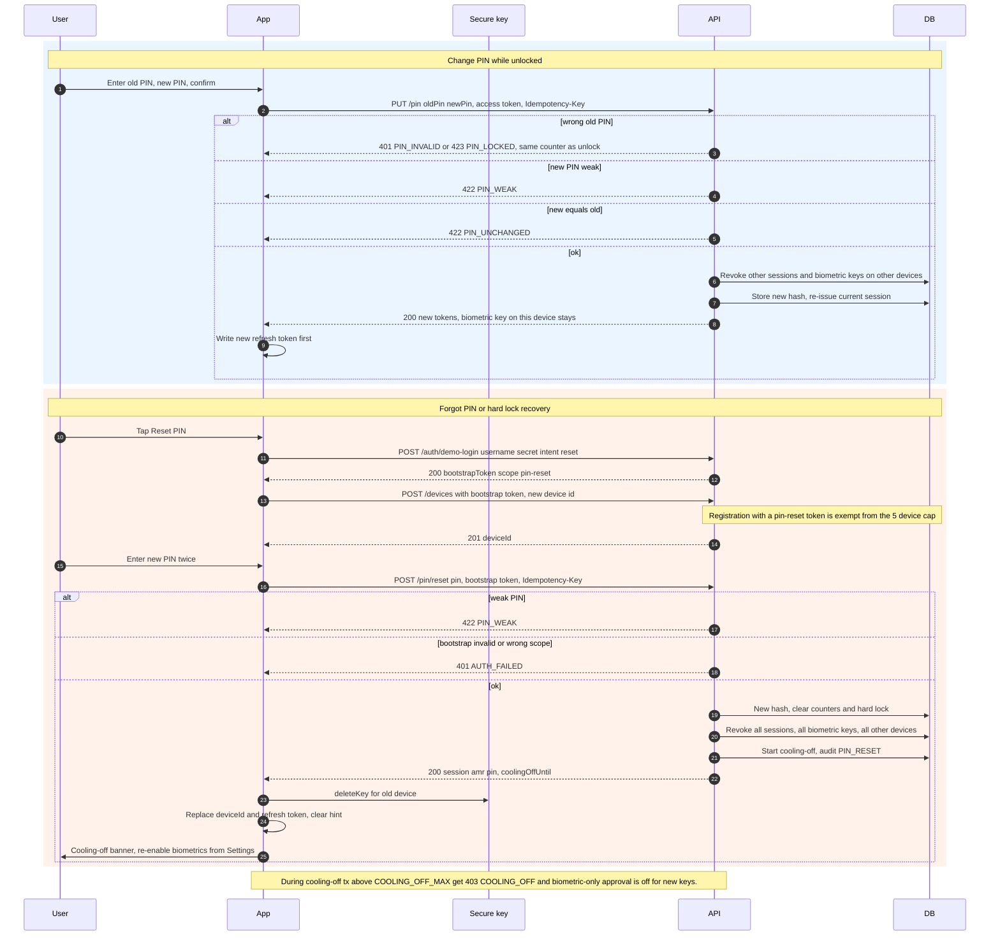
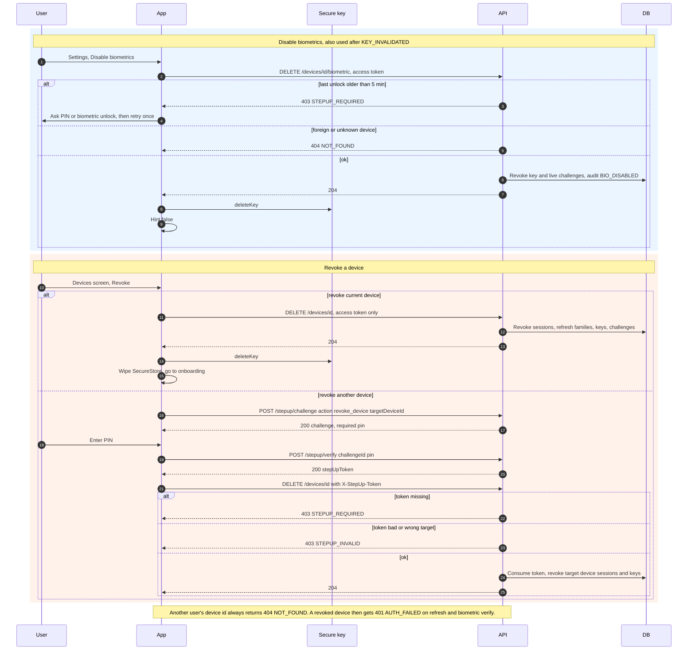
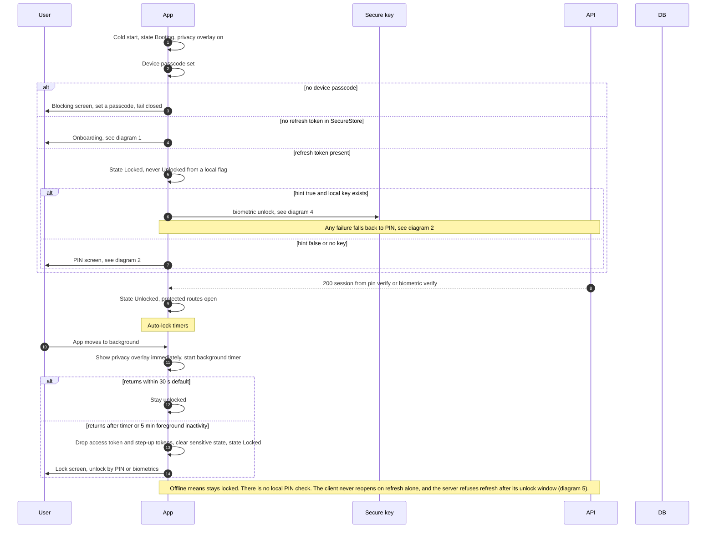

# Sequence diagrams: biometric-pin-login

Source of truth: [openapi.yaml](./openapi.yaml), [contract-notes.md](./contract-notes.md), [decisions.md](./decisions.md). All paths are under `/v1`. Participants: User, App (Expo), Secure key (Secure Enclave or Keystore), API (Go), DB (Postgres). Tokens travel only in headers. The PIN travels only in JSON bodies.

## 1. First launch, demo-login, device registration, PIN setup

SEC: 001, 002, 004, 015, 016, 034, 048, 052, 053, 060.

## 2. PIN unlock with soft lock and hard lock

SEC: 005, 005b, 008, 009, 010, 011, 012, 013, 014, 037.

## 3. Enable biometrics (two-step enroll with fresh PIN and proof of possession)

SEC: 017, 018, 020, 021, 022, 026, 027, 038, 042, 047, 054.

## 4. Biometric unlock with PIN fallback

SEC: 019, 023, 025, 026, 027, 028, 029, 030, 037, 054.

## 5. Refresh with rotation and reuse detection

SEC: 014, 031, 032, 033, 034, 035, 036, 037.

## 6. Step-up send transaction (biometric under BIO_ONLY_MAX, PIN above, server recomputed hash)

SEC: 026, 027, 038, 039, 040, 041, 042, 043, 044, 047, 060.

## 7. Change PIN, PIN reset and hard-lock recovery with cooling-off

SEC: 001, 011, 016, 024, 036, 045, 046, 047, 048.

## 8. Disable biometrics and revoke device

SEC: 023, 024, 036, 038, 048, 049.

## 9. App launch decision and auto-lock

SEC: 013, 019, 033, 034, 050, 051, 054.
